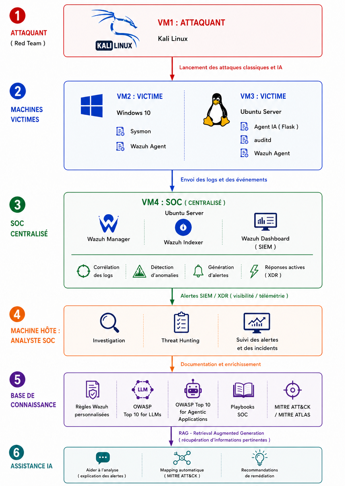

# Proactive-SOC-AI-Threat-Hunting
A proactive SOC lab integrating Wazuh SIEM/XDR, threat hunting, AI agent monitoring and RAG-based security assistance.

# Proactive SOC for Threat Hunting with AI Agent Monitoring

## 1. Project Overview

This project focuses on designing and implementing a proactive Security Operations Center (SOC) in a virtualized lab environment, using Wazuh for security monitoring and detection, and Retrieval-Augmented Generation (RAG) to provide AI-assisted security analysis.

The main objective is to monitor traditional IT infrastructure and AI agent behavior while supporting security analysts in threat detection, investigation and remediation.

The project explores the integration of SIEM/XDR capabilities, threat hunting, AI agent monitoring, and knowledge-based AI assistance within a unified security environment.

## 2. Architecture

The architecture consists of four main virtual machines:

- **VM1 — Kali Linux:** Attacking machine used to simulate security attack scenarios.
- **VM2 — Windows 10:** Monitored endpoint equipped with Sysmon and a Wazuh agent.
- **VM3 — Ubuntu Server:** Monitored Linux server equipped with a Wazuh agent and hosting an AI agent developed using Flask.
- **VM4 — SOC Infrastructure:** Centralized monitoring environment hosting the Wazuh Manager, Wazuh Indexer, and Wazuh Dashboard.

The collected security events are analyzed and presented to the SOC analyst through the Wazuh Dashboard.

## 3. Technologies Used

The project involves the following technologies and concepts:

- **SIEM/XDR:** Wazuh
- **Operating Systems:** Windows 10, Ubuntu Server, Kali Linux
- **Endpoint Monitoring:** Sysmon, Wazuh Agent
- **AI Agent:** Python, Flask
- **AI-Assisted Analysis:** Retrieval-Augmented Generation (RAG)
- **Security Frameworks:** MITRE ATT&CK, MITRE ATLAS, OWASP LLM, OWASP Agentic Apps
- **Virtualization:** Virtual machines

## 4. Attack Simulation and Security Monitoring

The lab is designed to simulate attack scenarios against monitored environments and investigate the resulting security events.

The monitoring workflow includes:

1. Generating security events through controlled attack simulations.
2. Collecting endpoint events using monitoring agents.
3. Analyzing events with Wazuh detection rules.
4. Visualizing and investigating generated alerts.
5. Using active response mechanisms when appropriate and configured.

Detailed scenario descriptions and detection results can be added as individual sections as the project documentation develops.

## 5. Attack Scenarios and Detection Results

Several attack scenarios were executed in the virtualized lab to evaluate the SOC's monitoring and detection capabilities.

| Attack Scenario | Execution Status | Detection Result |
|---|---|---|
| Network Reconnaissance (Nmap) | Executed | Successfully detected |
| RDP Brute-Force Attack | Executed | Successfully detected |
| Privilege Escalation | Executed | Successfully detected |
| Data Exfiltration | Executed | Successfully detected |
| AI Agent Monitoring and LLM Security Tests | Executed | Relevant security events detected |
| Man-in-the-Middle (MITM) | Executed | No relevant alert detected |
| Distributed Denial-of-Service (DDoS) | Executed | No relevant alert detected |

These experiments helped evaluate the monitoring capabilities of the lab and identify areas where detection coverage could be improved.

While several scenarios generated relevant security alerts, the MITM and DDoS experiments did not produce relevant alerts in the tested configuration. These results highlight the importance of validating detection rules, reviewing available telemetry, and identifying potential monitoring gaps.

The results are specific to the configurations and conditions tested in this laboratory and should not be interpreted as a general assessment of Wazuh's detection capabilities.

## 6. Security Knowledge Base

A security knowledge base was designed to bring together several sources of information, including:

- Custom Wazuh detection rules.
- OWASP guidance for LLM and agentic application security.
- MITRE ATT&CK and MITRE ATLAS.
- SOC investigation playbooks.

The purpose of this knowledge base is to provide relevant security context for alert analysis and investigation.

## 7. RAG-Based AI Assistant

The project includes an AI-assisted analysis component based on Retrieval-Augmented Generation (RAG).

The general workflow is:

1. Retrieve relevant information from the security knowledge base.
2. Provide the retrieved context to a language model.
3. Generate a contextualized explanation of the security event.
4. Suggest relevant MITRE techniques and remediation recommendations.

The assistant is intended to support the analyst's investigation rather than replace human judgment.

## 8. Project Scope and Limitations

This project was developed in a virtualized laboratory environment for experimentation and learning.

Its results reflect the scenarios and configurations tested in that environment. They should not be interpreted as proof of production readiness or universal detection effectiveness.

## 9. Future Improvements

Potential areas for further development include:

- Expanding the collection of documented attack scenarios.
- Improving detection rules and alert analysis.
- Extending the evaluation of AI agent security risks.
- Evaluating the accuracy and reliability of RAG-based recommendations.
- Improving the integration between security monitoring and AI-assisted investigation.

## 10. Disclaimer

This project is intended for educational and defensive cybersecurity purposes. Attack simulations should only be performed in authorized and controlled environments.
